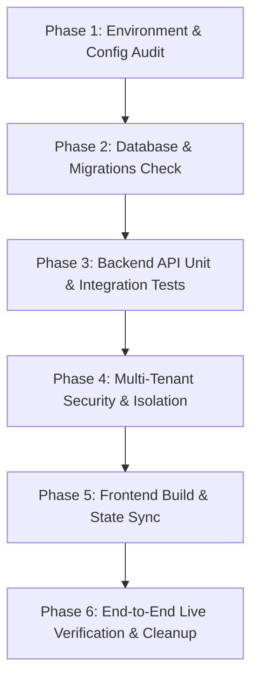

# SHE Twin AI — Comprehensive Test Plan

## 1. Project Overview
- **Project Name:** SHE Twin AI — AI-Powered Personalized Healthcare Platform
- **Architecture:** Client-Server Single Page Application (SPA) + REST API
- **Frontend Stack:** React 18, Vite, TypeScript, Tailwind CSS, Heroicons, Lucide React
- **Backend Stack:** Python 3.14, FastAPI, Pydantic v2, SQLAlchemy 2.0, Alembic
- **Database Engine:** Supabase PostgreSQL (PostgreSQL 17.11)
  - **Transaction Pooler:** Port 6543 / PgBouncer
  - **Session Pooler:** Port 5432 / Direct Migrations
- **Security:** JWT (HS256) Bearer Tokens, Salted Bcrypt Password Hashing, Multi-Tenant User Isolation

---

## 2. Test Objectives & Strategy
1. **Frontend Verification:** Validate UI rendering, forms, input sanitization, navigation, route protection, and real-time state synchronization.
2. **Backend API Testing:** Audit all HTTP endpoints for correct response schemas, status codes, error handling, and parameter validation.
3. **Database & Persistence Testing:** Verify that all data writes and reads target Supabase PostgreSQL, that records persist across separate database sessions, and that Alembic migrations reflect models accurately.
4. **Security & Isolation Testing:** Enforce multi-tenant access controls so that User A cannot view, update, or delete User B's health records under any circumstances.
5. **Report & AI Parsing Testing:** Validate PDF text extraction, clinical parameter regex parsing, normal range evaluation, and health assistant responses with medical disclaimers.

---

## 3. Scope of Testing

### In-Scope Modules
| Module | Components & Pages | Backend Endpoints |
| :--- | :--- | :--- |
| **Authentication** | `LoginPage`, `RegisterPage`, `AuthContext` | `POST /api/auth/register`, `POST /api/auth/login`, `GET /api/auth/me`, `POST /api/auth/logout` |
| **Digital Health Twin** | `HealthTwinPage`, `3D Body Canvas`, Biometrics Form | `GET /api/twin/profile`, `PUT /api/twin/profile`, `GET /api/twin/vitals`, `POST /api/twin/vitals`, `DELETE /api/twin/vitals/{id}` |
| **Dashboard** | `DashboardPage`, Summary Cards, Trends | `GET /api/dashboard` |
| **Medical Reports** | `ReportsPage`, Upload Modal, Comparator | `GET /api/reports`, `POST /api/reports/upload`, `GET /api/reports/{id}`, `GET /api/reports/compare`, `DELETE /api/reports/{id}` |
| **Women's Health** | `WomensHealthPage`, Menstrual Cycle Log | `GET /api/womens-health/cycles`, `POST /api/womens-health/cycles`, `DELETE /api/womens-health/cycles/{id}` |
| **Family Health Hub** | `FamilyHealthPage`, Family Member Tree | `GET /api/family/members`, `POST /api/family/members`, `PUT /api/family/members/{id}`, `DELETE /api/family/members/{id}` |
| **Doctor Directory** | `DoctorsPage`, Appointment Booking | `GET /api/doctors`, `GET /api/doctors/appointments`, `POST /api/doctors/appointments` |
| **AI Health Assistant** | `AssistantPage`, Chat Interface | `POST /api/assistant/chat` |
| **Settings & Privacy**| `SettingsPage`, Password Change, Data Export | `GET /api/settings`, `PUT /api/settings`, `POST /api/settings/change-password`, `GET /api/settings/export-data`, `DELETE /api/settings/account` |

---

## 4. Test Execution Phases

1. **Phase 1 (Config Audit):** Validate `backend/.env` without exposing secrets.
2. **Phase 2 (Database Check):** Verify Supabase PostgreSQL connection on port 6543/5432 and inspect 10 tables.
3. **Phase 3 (API Testing):** Run Pytest test suite and automated API test client against all endpoints.
4. **Phase 4 (Security Audit):** Perform cross-user boundary testing (User B querying User A's IDs).
5. **Phase 5 (Frontend Build):** Run `tsc` and `vite build` to guarantee zero syntax or bundling errors.
6. **Phase 6 (Live Verification):** Execute `verify_live_api.py` and `run_full_system_audit.py` to confirm end-to-end data lifecycle.
